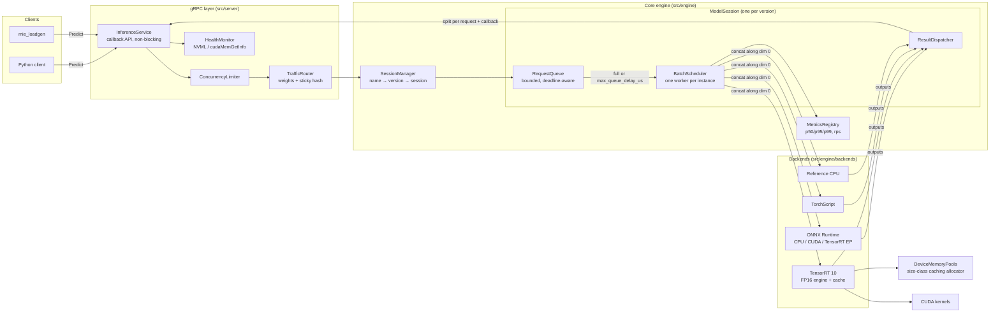

# ml-inference-engine

[](https://github.com/swan28pande/ml-inference-engine/actions/workflows/ci.yml)

A C++17 model-serving system for low-latency, high-throughput inference. It loads ONNX
(and TorchScript) models, runs them on ONNX Runtime or native TensorRT, merges concurrent
requests into GPU-sized batches, and serves them over gRPC with health checks, model
versioning and A/B traffic routing.

```
client ──gRPC──► admission control ─► traffic router ─► per-model batch queue ─► backend instances ─► scatter results
                 (in-flight limit)     (A/B weights,     (max batch / max delay,   (ONNX Runtime,
                                        sticky keys)      shape-aware grouping)     TensorRT, LibTorch)
```

## Features

- **ONNX / TorchScript models.** ONNX models run on the ONNX Runtime C++ API (CPU, CUDA or TensorRT execution providers). TorchScript models run on a LibTorch backend.
- **TensorRT optimization.** The native TensorRT 10 backend compiles ONNX into an FP16 engine with dynamic-batch optimization profiles and caches the engine on disk. FP16 conversion happens on the GPU with custom CUDA kernels, so clients keep a float32 API.
- **Dynamic batching.** Requests are grouped until the batch is full or the oldest request has waited `max_queue_delay_us`. Only requests with matching input shapes are merged. Preferred batch sizes and per-request deadlines are supported.
- **GPU memory pooling.** A size-class caching allocator (power-of-two buckets, pre-allocation, idle-cache cap, out-of-memory trim-and-retry) means steady-state inference makes no `cudaMalloc`/`cudaFree` calls. The same pool also manages pinned and pageable host memory.
- **Low latency at high throughput.** The measured end-to-end gRPC result is **33K req/s at 4.3 ms p99**, on CPU only, for the small sample model (see [Benchmarks](#benchmarks)). The design target on a single GPU is sub-10 ms p99 at 5K+ req/s.
- **gRPC API with health checks.** It serves Predict, Health, model metadata, ListModels, runtime traffic splits and metrics (JSON-style and Prometheus text), plus the standard `grpc.health.v1` service.
- **Model versioning.** Multiple versions of a model can be loaded side by side. An unloaded version stays alive until its in-flight requests finish.
- **A/B routing.** Weighted traffic splits between versions can be changed at runtime. Requests with a `routing_key` get sticky (hashed) assignment. Versions that aren't ready are skipped automatically.
- **Graceful shutdown.** On SIGTERM the server stops admitting requests and reports DRAINING, drains in-flight work within a deadline, then stops schedulers and the transport.
- **Request queue with concurrency limits.** The server has a global in-flight limit, and each model has a bounded queue. Overload returns `RESOURCE_EXHAUSTED` instead of building unbounded latency.
- **Metrics.** Lock-free log-linear histograms (about 6% error) report p50, p95 and p99 for end-to-end, queue and compute latency, along with throughput, mean batch size and reject counts.

## Architecture



**Request lifecycle**

1. `Predict` arrives on a gRPC callback thread. If the server is draining it returns `UNAVAILABLE`. If the in-flight limit is reached it returns `RESOURCE_EXHAUSTED`.
2. The traffic router picks a version: the pinned version if one was requested, otherwise a sticky hash of the routing key or a weighted random choice, falling back to the latest READY version.
3. The request is validated, gets a batch signature (input names, dtypes and non-batch dims), and is pushed onto that version's bounded queue. No gRPC thread blocks.
4. A scheduler worker forms a batch, concatenates inputs along dim 0 and calls `ModelBackend::Infer`. Each backend instance runs one batch at a time, so non-reentrant runtimes such as TensorRT execution contexts are safe. Parallelism comes from `instance_count`.
5. The `ResultDispatcher` splits every output back by each request's batch size, applies output filters, records metrics, and completes the gRPC reactor.

## Repository layout

```
include/mie/        public headers
  common/           Status/StatusOr, Tensor + batch concat/split, logging
  memory/           MemoryPool, DeviceMemoryPools, CUDA helpers + kernels
  engine/           ModelBackend, RequestQueue, BatchScheduler, ResultDispatcher,
                    ModelSession, SessionManager, metrics, ConcurrencyLimiter
  engine/backends/  onnxruntime, tensorrt, torchscript, reference
  server/           gRPC server, TrafficRouter, HealthMonitor, config loader
src/                implementations (same layout); src/memory/cuda_kernels.cu
proto/              inference.proto (public API), server_config.proto (config schema)
configs/            server.pbtxt (CPU), server.gpu.pbtxt (TensorRT), server.reference.pbtxt
models/             sample ONNX models + generator script
tests/              GoogleTest unit + end-to-end tests
benchmarks/         mie_engine_benchmark (engine), mie_loadgen (gRPC load generator)
client/             Python gRPC client
docker/             GPU Dockerfile
```

## Building

### Dependencies

| Dependency | Required | Notes |
|---|---|---|
| CMake ≥ 3.20, C++17 compiler | yes | GCC 11+, Clang 14+ |
| gRPC + Protobuf | for the server | Ubuntu: `libgrpc++-dev protobuf-compiler-grpc` |
| ONNX Runtime | optional (`MIE_WITH_ONNXRUNTIME`, default ON) | `scripts/fetch_onnxruntime.sh` downloads a release |
| CUDA Toolkit 12.x | optional (`MIE_WITH_CUDA`) | device memory pool, kernels, NVML |
| TensorRT 10.x | optional (`MIE_WITH_TENSORRT`) | requires CUDA |
| LibTorch | optional (`MIE_WITH_TORCH`) | TorchScript backend |
| GoogleTest | for tests | uses the system package or fetches v1.15.2 |

GPU code sits behind `MIE_WITH_CUDA` / `MIE_WITH_TENSORRT` / `MIE_WITH_TORCH` guards, so a
CPU-only build compiles and tests everything else.

### CPU build (Ubuntu 24.04)

```bash
sudo apt-get install -y build-essential cmake ninja-build pkg-config \
  libgrpc++-dev libprotobuf-dev protobuf-compiler protobuf-compiler-grpc libgtest-dev
scripts/fetch_onnxruntime.sh                      # -> third_party/onnxruntime

cmake -S . -B build -G Ninja -DCMAKE_BUILD_TYPE=Release \
      -DONNXRUNTIME_ROOT=$PWD/third_party/onnxruntime
cmake --build build --parallel
ctest --test-dir build --output-on-failure
```

### GPU build (CUDA + TensorRT)

```bash
scripts/fetch_onnxruntime.sh --gpu
cmake -S . -B build -G Ninja -DCMAKE_BUILD_TYPE=Release \
      -DONNXRUNTIME_ROOT=$PWD/third_party/onnxruntime \
      -DMIE_WITH_CUDA=ON -DMIE_WITH_TENSORRT=ON \
      -DMIE_CUDA_ARCHITECTURES="80;86;89;90"
cmake --build build --parallel
```

Other options: `-DMIE_WITH_TORCH=ON -DCMAKE_PREFIX_PATH=/path/to/libtorch`,
`-DMIE_SANITIZER=address|thread`, `-DMIE_WARNINGS_AS_ERRORS=ON`, `-DMIE_BUILD_SERVER=OFF`
(engine library only, no gRPC dependency).

## Running

```bash
build/src/mie_server --config configs/server.pbtxt            # 2 versions of the sample MLP, 90/10 split
build/src/mie_health_probe --address localhost:50051          # exit 0 when SERVING

pip install -r client/requirements.txt
python client/inference_client.py demo                        # health, metadata, predict, load, metrics
python client/inference_client.py predict --model mlp --batch 4
python client/inference_client.py split --model mlp --weights 1=50,2=50
python client/inference_client.py metrics --prometheus
```

### Configuration

Server configuration uses protobuf text format, with the schema in
[`proto/server_config.proto`](proto/server_config.proto):

```protobuf
models {
  name: "mlp"  version: "2"  backend: "tensorrt"  path: "../models/sample/mlp_v2.onnx"
  use_gpu: true  instance_count: 2  warmup_iterations: 20
  batching { max_batch_size: 128  max_queue_delay_us: 300  preferred_batch_sizes: [32, 64, 128] }
  parameters { key: "fp16" value: "1" }
}
traffic { model_name: "mlp"  weights { key: "1" value: 90 }  weights { key: "2" value: 10 } }
device_memory_pool { max_cached_bytes: 2147483648  preallocate { bytes: 1048576 count: 16 } }
```

Backend parameters are documented in each backend header under
[`include/mie/engine/backends/`](include/mie/engine/backends).

## Docker

```bash
docker compose up --build               # CPU server + Python client running the demo
docker build -t mie-server .            # CPU image (ONNX Runtime)
docker run --rm -p 50051:50051 mie-server

# GPU image (CUDA 12 + TensorRT 10 base), needs the NVIDIA Container Toolkit
docker build -f docker/Dockerfile.gpu -t mie-server:gpu .
docker run --rm --gpus all -p 50051:50051 mie-server:gpu
docker compose --profile gpu up --build inference-server-gpu
```

The CPU image runs the unit tests during the build, runs as a non-root user, has a
`HEALTHCHECK` that uses `mie_health_probe`, and drains gracefully on `docker stop`.

## Benchmarks

Two tools, both under `benchmarks/`:

- `mie_engine_benchmark` sweeps max batch sizes through the scheduler and backend with no network. It supports closed-loop mode (N concurrent clients) and open-loop mode (`--rate`, which measures from the scheduled send time to avoid coordinated omission).
- `mie_loadgen` is a C++ gRPC load generator. It spreads clients over several HTTP/2 connections and reports client-observed p50/p95/p99 plus server-side queue and compute time.

### Measured results (CPU only)

Hardware: Apple M1 (8 cores), ONNX Runtime 1.22 on CPU, Release build. The load
generator runs on the same machine, so it competes with the server for cores. All
latencies are client-observed.

**End-to-end gRPC.** `mie_server --config configs/server.pbtxt`, sample MLP (16→64→64→4),
batch 1 per request, 90/10 A/B split, 8 connections:

| clients | throughput | p50 | p95 | p99 | mean executed batch |
|---:|---:|---:|---:|---:|---:|
| 16 | 18,401 req/s | 0.83 ms | 1.17 ms | 1.33 ms | 12.4 |
| 64 | 33,210 req/s | 1.78 ms | 3.19 ms | 4.32 ms | 30.8 |

**Engine, effect of dynamic batching.** These runs use 64 closed-loop clients.

The first table is a larger MLP (256→1024→1024→10, 2.3M parameters, generated with
`models/generate_sample_models.py --large`) on ONNX Runtime CPU with 4 instances:

| max batch | throughput | p50 | p99 |
|---:|---:|---:|---:|
| 1 (no batching) | 6,962 req/s | 8.49 ms | 19.63 ms |
| 4 | 30,384 req/s | 2.03 ms | 3.60 ms |
| 16 | 32,983 req/s | 1.94 ms | 2.80 ms |
| 64 | 19,635 req/s | 3.24 ms | 3.77 ms |

The second table uses the reference backend with a simulated accelerator cost model
(400 µs fixed per batch plus 5 µs per sample, 2 instances). This mimics GPU kernel-launch
overhead, which is what batching amortizes:

| max batch | throughput | p50 | p99 |
|---:|---:|---:|---:|
| 1 | 3,590 req/s | 17.65 ms | 31.12 ms |
| 8 | 25,473 req/s | 2.46 ms | 3.45 ms |
| 32 | 55,900 req/s | 1.07 ms | 2.49 ms |

To reproduce:

```bash
build/benchmarks/mie_engine_benchmark --backend onnxruntime --model models/sample/mlp_large.onnx \
    --instances 4 --concurrency 64 --batch_sizes 1,4,16,32,64
build/benchmarks/mie_engine_benchmark --backend reference --fixed_latency_us 400 \
    --per_sample_latency_us 5 --instances 2 --concurrency 64
build/benchmarks/mie_loadgen --address localhost:50051 --model mlp --concurrency 64 --duration_s 10
```

### GPU results

GPU numbers haven't been measured for this repository yet. The TensorRT and CUDA code
compiles in CI, but hosted runners have no GPU. To measure on a GPU host:

```bash
docker build -f docker/Dockerfile.gpu -t mie-server:gpu .
docker run --rm --gpus all -p 50051:50051 mie-server:gpu
docker run --rm --gpus all --network host --entrypoint mie_loadgen mie-server:gpu \
    --address localhost:50051 --model mlp --concurrency 128 --duration_s 30
```

| GPU | model | backend | throughput | p50 | p99 |
|---|---|---|---:|---:|---:|
| _to be measured_ | | TensorRT FP16 | | | |

## Testing

`ctest` runs about 75 GoogleTest cases covering:

- **Batching logic:** max batch and max delay dispatch, shape-aware grouping, preferred sizes, FIFO under overflow, deadlines, queue limits, drain and no-drain shutdown, and checks that batched results match unbatched results.
- **Memory pool:** size classes, block reuse, pre-allocation, cache cap, oversize bypass, trim, allocation failure, and concurrent acquire/release.
- **Model loading:** backend factory, reference and ONNX Runtime backends, the session manager's version resolution, and unloading while a request still holds the session.
- **Server end-to-end:** an in-process gRPC server for Predict, Health, metadata, ListModels, A/B and sticky routing, runtime split updates, metrics, the concurrency limit, and graceful shutdown with in-flight requests.
- **Metrics:** histogram accuracy against exact percentiles, and concurrency.

CI (GitHub Actions) builds and tests these configurations:

- CPU with ONNX Runtime
- CPU minimal
- ASan + UBSan
- TSan (engine only)
- CUDA + TensorRT, compile-only
- the Docker image, with a container health and load smoke test

## Tech stack

C++17 · CUDA · TensorRT · ONNX Runtime · LibTorch (optional) · gRPC · Protobuf · CMake ·
GoogleTest · Docker · GitHub Actions · Python (client)

## License

MIT. See [LICENSE](LICENSE).
